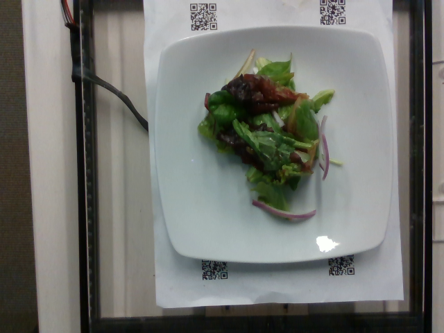
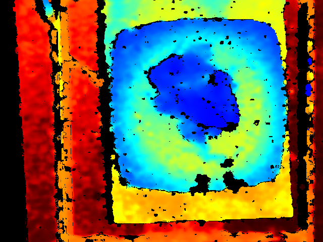

# 食品卡路里预测系统 (Food Calorie Prediction)

这是一个基于深度学习的多模态食品卡路里预测项目。通过结合食物的 **RGB 彩色图像** 和 **深度图像 (Depth)**，使用 PyTorch 搭建神经网络模型，实现对食物卡路里的精准预测。

## 效果展示 (Demo)

以下是模型在测试集上的部分表现，左侧为原始 RGB 图像，右侧为对应的深度图：

### 示例 1 (编号: 1556573514)

| 真实的彩色照片 (RGB) | 深度图 (Depth Color) |
| :---: | :---: |
|  |  |

---

## 项目目录结构

```text
Food-Calorie-Prediction/
├── assets/                  # 演示用图片 (RGB 与深度图)
├── python_food/             # 核心代码
│   ├── models/              # 网络模型定义
│   ├── utils/               # 数据处理工具
│   └── train.py             # 训练脚本
└── README.md                # 项目说明文档
